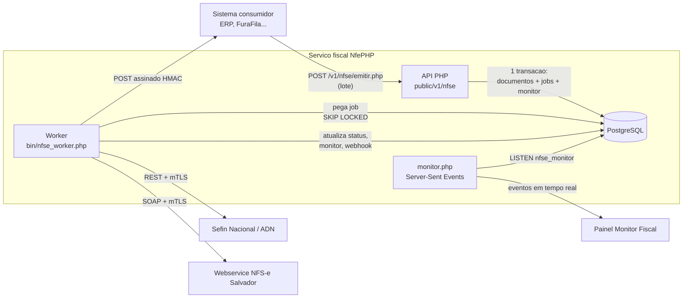
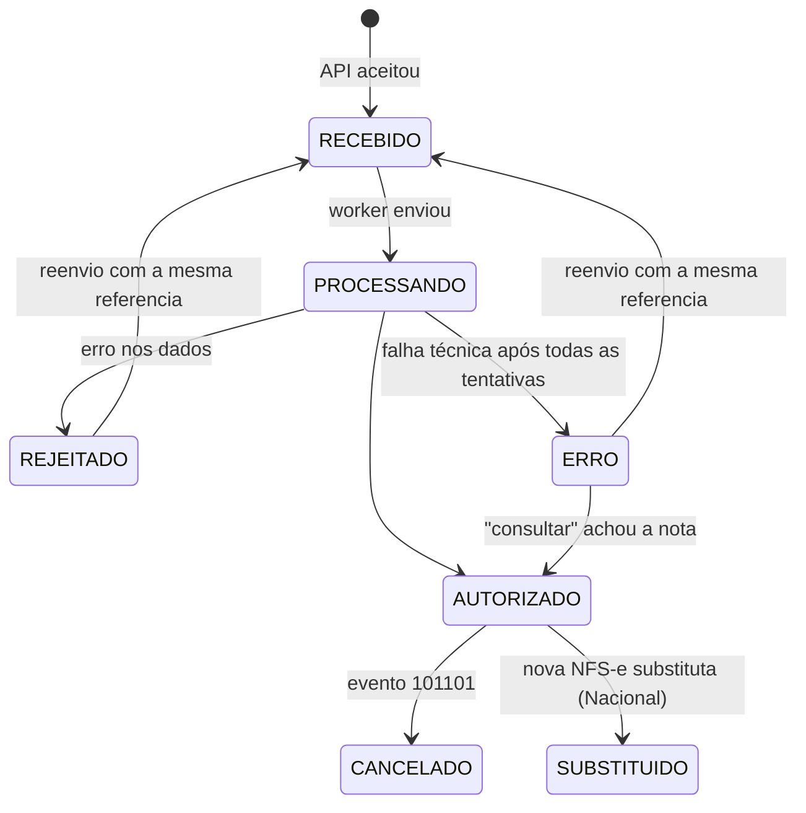

# NFS-e — Arquitetura (Padrão Nacional e Salvador-BA)

Este documento explica **como a emissão de NFS-e funciona por dentro**: o
caminho de um lote desde a chamada da API até a nota autorizada, a fila, o
worker, os eventos e o monitor em tempo real.

Leitura complementar:

- `docs/nfse-guia-api.md` — contrato da API, com exemplos para quem integra.
- `docs/nfse-duvidas-processo.md` — decisões de processo que precisam da sua definição.
- `schemas/nfse/README.md` — XSDs oficiais e o ajuste local feito neles.

---

## 1. Visão geral em uma frase

> A API **só recebe e guarda**; um **worker** em segundo plano fala com o
> fisco; cada mudança vira uma linha no **feed do monitor** que o painel
> recebe na hora (SSE) e o sistema consumidor recebe por **webhook**.



---

## 2. Por que essa estrutura (fila + worker + SSE + webhook)

Você pediu para avaliar worker, fila, webhook, WebSocket e SSE. A escolha foi
**usar cada um onde ele é melhor**, sem adicionar infraestrutura nova.

| Peça | Escolha | Por quê |
|---|---|---|
| **Fila** | Tabela `nfse_jobs` no PostgreSQL com `FOR UPDATE SKIP LOCKED` | O Postgres já é obrigatório. O job é gravado **na mesma transação** do documento: nunca existe nota sem job nem job sem nota. Vários workers podem rodar em paralelo sem pegar o mesmo job. Volume de NFS-e (dezenas a milhares por dia) está muito abaixo do limite desse modelo. RabbitMQ/Redis só trariam mais um serviço para operar. |
| **Worker** | Processo CLI contínuo (`bin/nfse_worker.php`) gerenciado por systemd/supervisor | Salvador é **assíncrono** (lote → protocolo → consultar depois); o Nacional pode demorar ou cair. Nada disso deve prender a requisição HTTP do consumidor. O worker também faz retentativa com espera exponencial e recupera jobs de workers que morreram. |
| **Acordar o worker** | `LISTEN/NOTIFY` do PostgreSQL | O worker dorme até chegar um aviso de job novo (ou 5 s, para jobs agendados). Reação imediata sem ficar consultando o banco em loop. |
| **Painel em tempo real** | **SSE** (`/v1/nfse/monitor.php`) alimentado por `LISTEN nfse_monitor` | O painel só **recebe** (servidor → navegador). SSE é HTTP comum: passa por proxy/firewall, o navegador **reconecta sozinho** e manda o `Last-Event-ID`, e retomamos exatamente de onde parou (o feed é uma tabela com id crescente — nada se perde). WebSocket seria bidirecional, exige servidor próprio em PHP (Ratchet/Swoole) e não traz ganho aqui. |
| **Avisar o sistema consumidor** | **Webhook** com padrão *outbox* (`nfse_webhooks_saida`) | Sistemas externos não ficam com navegador aberto; webhook é o padrão de mercado. O aviso é gravado no banco junto com a mudança de status e entregue depois, com até 10 tentativas e assinatura HMAC. Se o webhook falhar, o consumidor ainda pode consultar a API. |
| **Quem não quer webhook** | `?aguardar=N` e `GET lote.php` | Integrações simples podem pedir para a API esperar até N segundos (máx. 60) e/ou consultar o lote depois (polling). |

### Por que não WebSocket?
- O painel não envia nada pelo canal em tempo real (filtros e ações usam a API REST normal).
- Em PHP, WebSocket exige um servidor de longa duração separado; SSE roda no PHP-FPM/nginx que já existe.
- Em Node/TypeScript (migração futura), SSE é ~20 linhas com `res.write()`; se um dia precisar de WebSocket, a fonte de dados (`nfse_monitor` + `NOTIFY`) continua a mesma.

### Limite conhecido do SSE em PHP
Cada painel aberto ocupa **um processo PHP-FPM** enquanto conectado. Por isso
a conexão é encerrada pelo servidor a cada ~5 minutos (o navegador reconecta
sem perder eventos). Para poucos painéis (equipe fiscal) isso é ok. Se forem
dezenas de telas simultâneas, reserve um *pool* PHP-FPM só para o monitor ou
mova apenas esse endpoint para Node primeiro.

---

## 3. Fluxo de emissão em lote

```mermaid
sequenceDiagram
    autonumber
    participant C as Consumidor
    participant API as API (emitir.php)
    participant DB as PostgreSQL
    participant W as Worker
    participant F as Fisco
    C->>API: POST lote (N documentos)
    API->>API: valida TODOS (ValidadorPayload)
    alt algum invalido
        API-->>C: 422 + erros por documento (nada gravado)
    else todos validos
        API->>DB: BEGIN; lote; numero DPS/RPS; documentos; jobs EMITIR; monitor; COMMIT
        DB-->>W: NOTIFY nfse_jobs
        API-->>C: 202 + id de cada documento (status RECEBIDO)
        loop para cada job
            W->>DB: pega job (SKIP LOCKED) e marca PROCESSANDO
            W->>F: envia DPS (Nacional) ou lote RPS (Salvador)
            F-->>W: resposta
            W->>DB: status + XML + mensagens; monitor (NOTIFY); webhook (outbox)
        end
    end
```

Pontos importantes:

1. **Validação tudo-ou-nada na entrada.** Se 1 de 10 documentos estiver
   inválido, nenhum é gravado e a resposta diz exatamente o erro de cada um.
   (Decisão a confirmar — ver dúvidas.)
2. **Cada documento é independente depois de aceito.** No Sefin Nacional não
   existe lote (uma DPS por chamada). Em Salvador enviamos **um RPS por
   lote**, porque no ABRASF um erro em um RPS derruba o lote inteiro.
3. **A numeração da DPS/RPS é reservada na entrada**, dentro da transação
   (`nfse_numeracao`). Se a transação falhar, o número volta. Uma vez
   reservado, o número fica com o documento para sempre — inclusive nas
   retentativas — e é isso que impede nota duplicada.

### 3.1 Padrão Nacional (síncrono)

```
EMITIR ──► monta DPS ► assina ► valida XSD ► POST /nfse
              │
              ├─ 201 + chaveAcesso ............ AUTORIZADO (guarda XML da NFS-e)
              ├─ 400 + erros .................. REJEITADO (mensagens do Sefin)
              └─ timeout / 5xx / 429 / 401-403  falha temporária → nova tentativa
                                                (30s, 60s, 120s... até 5x) → ERRO
```

**Proteção contra duplicidade:** se uma tentativa anterior chegou a enviar a
DPS (timeout no meio do caminho), a próxima tentativa **primeiro pergunta**
`GET /dps/{idDps}`. Se a DPS já virou nota, só baixa a NFS-e. Nunca
reenviamos às cegas.

### 3.2 Salvador (assíncrono)

```
EMITIR ──► monta lote (1 RPS) ► assina RPS ► assina lote ► valida XSD ► EnviarLoteRPS
              │
              ├─ Protocolo ................ PROCESSANDO → agenda CONSULTAR_PROCESSAMENTO (15s)
              └─ ListaMensagemRetorno ..... REJEITADO

CONSULTAR_PROCESSAMENTO ──► ConsultarSituacaoLoteRPS
              ├─ 1/2 (não recebido / não processado) ... continua PROCESSANDO (consulta a cada 30s, até 20x)
              ├─ 3 (processado com erro) ► ConsultarLoteRPS ... REJEITADO (mensagens)
              └─ 4 (processado com sucesso) ► ConsultarLoteRPS ... AUTORIZADO (número + código de verificação)
```

Se o envio caiu **antes** de receber o protocolo, a próxima tentativa faz
`ConsultarNfseRPS` antes de reenviar.

---

## 4. Status padronizado

O consumidor só conhece estes status, iguais para todos os padrões
(`src/Nfse/Dominio/StatusNfse.php`):



| Status | Significado para o consumidor | Pode reenviar? |
|---|---|---|
| `RECEBIDO` | Na fila. | — |
| `PROCESSANDO` | Enviado ao fisco, aguardando. | Não |
| `AUTORIZADO` | NFS-e gerada; XML e PDF disponíveis. | Não (idempotente) |
| `REJEITADO` | Fisco recusou os dados. Corrija e reenvie com a **mesma referência**. | Sim |
| `ERRO` | Falha técnica persistente. **Use "consultar" antes de reenviar.** | Sim |
| `CANCELADO` | Cancelada por evento. | Não |
| `SUBSTITUIDO` | Substituída por outra NFS-e (Nacional). | Não |

**Idempotência por `referencia`:** o mesmo consumidor enviando a mesma
`referencia` (ex.: número do pedido) nunca gera duas notas. Se o documento
existente estiver `REJEITADO`/`ERRO`, os dados novos são aceitos e o mesmo
número de DPS/RPS é reaproveitado.

---

## 5. Eventos (cancelamento etc.)

Os eventos usam a **numeração do Padrão Nacional** para todos os padrões,
assim o consumidor tem um contrato só. O que cada padrão aceita está em
`src/Nfse/Dominio/Capacidades.php` e é exposto em `GET /v1/nfse/capacidades.php`.

| Evento | Nacional | Salvador |
|---|---|---|
| 101101 Cancelamento | ✅ | ❌ só pelo portal / processo administrativo |
| 101103 Solicitação de análise fiscal p/ cancelamento (fora do prazo) | ✅ | ❌ |
| 105102 Cancelamento por substituição | ✅ automático ao emitir com `substituicao` | ❌ |
| Consulta de situação | ✅ (NFS-e + eventos) | ✅ (lote / RPS) |
| PDF | DANFSe oficial (ADN) | Espelho gerado pela API |
| Confirmação/rejeição (202201, 202205...) | previsto, não implementado | ❌ |
| Eventos do fisco (105104, 305101...) | detectados na consulta | — |

Fluxo: `POST /v1/nfse/evento.php` → validações (padrão suporta? nota
autorizada? motivo 15–255 caracteres?) → `nfse_eventos` + job `EVENTO` →
worker assina e envia → `REGISTRADO` (documento vira `CANCELADO`) ou
`REJEITADO`. Pedidos repetidos devolvem o mesmo evento.

Em Salvador a API **recusa na entrada** (HTTP 422, código
`NAO_SUPORTADO_PELO_PADRAO`) com a orientação da prefeitura, sem chamar o
webservice.

---

## 6. Monitor fiscal

### Fonte de dados
Tabela `nfse_monitor` (só cresce). Cada linha: documento, lote, consumidor,
padrão, referência, **operação** (`RECEBIMENTO`, `EMISSAO`, `CONSULTA`,
`EVENTO`), status, mensagem, número/chave. Toda gravação dispara
`pg_notify('nfse_monitor', id)`.

### Entrega ao painel
1. **Carga inicial:** `GET /v1/nfse/documentos.php` (estado atual de cada nota).
2. **Tempo real:** `EventSource('/v1/nfse/monitor.php?token=...')` — cada
   evento `nfse` traz a linha do monitor; o painel atualiza a nota pelo
   `documento_id`.
3. **Linha do tempo de uma nota:** `GET /v1/nfse/documento.php?id=...&historico=1`.

Assim o painel mostra cada nota **quando é recebida, enviada, autorizada,
rejeitada, consultada ou cancelada**, inclusive as falhas temporárias
("tentativa 2/5, nova tentativa em 60s").

Exemplo de painel mínimo: ver `docs/nfse-guia-api.md`, seção "Monitor".

---

## 7. Organização do código

```
src/Nfse/
├── Dominio/            Vocabulário comum: StatusNfse, StatusEvento, Padrao, TipoEvento, Capacidades
├── Contrato/           ProvedorNfse (interface) e RetornoProvedor (resposta padronizada)
├── Nacional/           Padrão Nacional: DpsXmlBuilder, EventoXmlBuilder, SefinNacionalCliente, ProvedorNacional
├── Salvador/           Salvador: RpsXmlBuilder, SalvadorSoapCliente, ProvedorSalvador
├── Infra/              Técnico: AssinadorXml, ValidadorXsd, CertificadoCliente, CurlTransporte, Xml
├── Pdf/                EspelhoNfsePdf (PDF auxiliar para quem não tem PDF oficial)
├── Repositorio/        TODO o SQL: documentos, fila, eventos, monitor, webhooks
├── Servico/            Regras do fluxo: RecebimentoLote, ProcessadorJobs, Solicitacoes, webhooks
├── Api/                Api.php: autenticação, JSON e erros comuns aos endpoints
├── NfseConfig.php      Junta config/nfe.php + config/nfse.php
└── ProvedorFactory.php Escolhe o provedor pelo padrão

public/v1/nfse/         Endpoints HTTP (um arquivo por rota, como em public/v1/nfe)
bin/nfse_worker.php     Worker
database/scripts/0002_nfse_criar_base.sql
schemas/nfse/           XSDs oficiais
tests/nfse/             Testes (php tests/nfse/executar.php)
```

**Regras de convivência (para manter simples):**

1. Endpoint não tem SQL nem XML: só chama serviço e responde.
2. Serviço não conhece XML de prefeitura: só conversa com `ProvedorNfse`.
3. Provedor não acessa banco: recebe o documento e devolve `RetornoProvedor`.
4. SQL só dentro de `Repositorio/`.
5. Montagem de XML só com `DOMDocument` (helper `Infra/Xml`), nunca concatenando texto.
6. Todo XML é validado no XSD oficial **antes** de ir ao fisco.

### Como incluir um novo município
1. `Dominio/Padrao.php`: nova constante.
2. `src/Nfse/<Municipio>/Provedor<Municipio>.php` implementando `ProvedorNfse` (copie Salvador como base se for ABRASF).
3. `ProvedorFactory` e `Dominio/Capacidades`.
4. Novo script SQL liberando o valor nos `CHECK (padrao IN ...)`.
5. XSDs em `schemas/nfse/<municipio>/` e testes em `tests/nfse/executar.php`.

---

## 8. Banco de dados

Script: `database/scripts/0002_nfse_criar_base.sql` (segue `docs/padrao-scripts-sql.md`).

| Tabela | Papel |
|---|---|
| `nfse_lotes` | Uma linha por chamada de emissão. |
| `nfse_documentos` | Estado atual de cada NFS-e (payload, números, status, XMLs, mensagens). |
| `nfse_numeracao` | Último número de DPS/RPS por CNPJ + padrão + ambiente + série. |
| `nfse_eventos` | Cancelamentos e demais eventos. |
| `nfse_jobs` | Fila do worker. |
| `nfse_monitor` | Feed append-only do painel. |
| `nfse_webhooks_saida` | Avisos pendentes para os consumidores. |

Decisões: status em `VARCHAR + CHECK` (fácil de evoluir e vira *union type*
em TypeScript), datas `TIMESTAMPTZ`, identificadores fiscais como texto
(CNPJ alfanumérico), IDs públicos em UUID e **XML guardado no banco** (API e
worker podem estar em servidores diferentes sem disco compartilhado).

---

## 9. Segurança

- Autenticação por **token por consumidor** (`config/nfse.local.php`,
  cabeçalho `X-NFE-API-TOKEN` ou `Authorization: Bearer`). Cada consumidor
  só enxerga os próprios documentos; o token do painel enxerga todos, mas
  não emite nem cancela.
- O **emitente vem da configuração**, nunca do corpo da requisição (mesma
  regra adotada no DF-e).
- Certificado A1: lido do `.pfx`; para o mTLS é gravado em arquivo
  temporário `0600` apagado ao fim do processo.
- Webhook assinado com `X-NFSe-Assinatura: sha256=<HMAC>`.
- Erros internos nunca expõem caminho/stack ao consumidor (vão para o log).
- Sem token configurado, a API só aceita chamadas de `127.0.0.1` (desenvolvimento).

---

## 10. Operação

### Worker (systemd)

```ini
# /etc/systemd/system/nfse-worker@.service
[Unit]
Description=Worker NFS-e %i
After=network-online.target postgresql.service

[Service]
WorkingDirectory=/var/www/nfe-integracao
ExecStart=/usr/bin/php bin/nfse_worker.php
Restart=always
RestartSec=5
User=www-data
KillSignal=SIGTERM
TimeoutStopSec=90

[Install]
WantedBy=multi-user.target
```

Subir 2 workers: `systemctl enable --now nfse-worker@1 nfse-worker@2`.

### nginx para o SSE

```nginx
location = /v1/nfse/monitor.php {
    fastcgi_buffering off;
    fastcgi_read_timeout 360s;
    include fastcgi_params;
    fastcgi_param SCRIPT_FILENAME $document_root$fastcgi_script_name;
    fastcgi_pass unix:/run/php/php8.3-fpm-monitor.sock;  # pool separado, opcional
}
```

### Consultas úteis

```sql
-- Fila agora
SELECT tipo, status, count(*) FROM nfse_jobs GROUP BY 1, 2;

-- Notas paradas há mais de 10 minutos
SELECT id, padrao, referencia, status, atualizado_em
  FROM nfse_documentos
 WHERE status IN ('RECEBIDO', 'PROCESSANDO') AND atualizado_em < now() - interval '10 minutes';

-- Webhooks que desistiram
SELECT * FROM nfse_webhooks_saida WHERE status = 'FALHOU' ORDER BY id DESC LIMIT 20;
```

### Testes

```bash
php tests/nfse/executar.php
```

Com banco descartável (fila, worker e monitor de verdade):

```bash
NFSE_TESTE_PG="pgsql:host=127.0.0.1;dbname=nfephp_teste;user=nfephp_app;password=..." php tests/nfse/executar.php
```

---

## 11. Portabilidade para Node.js + TypeScript

O desenho foi feito para a migração ser **tradução**, não reescrita:

| PHP hoje | Node/TS amanhã |
|---|---|
| `StatusNfse`, `Padrao`, `TipoEvento` (constantes) | `type StatusNfse = 'RECEBIDO' \| ...` |
| `ProvedorNfse` (interface) | `interface ProvedorNfse` idêntica |
| `RetornoProvedor` (objeto imutável) | `type RetornoProvedor` + funções construtoras |
| `TransporteHttp` / `CurlTransporte` | `fetch`/`undici` com `Agent({ cert, key })` |
| `AssinadorXml` | `xml-crypto` (mesmo C14N e algoritmos) |
| `ValidadorXsd` | `libxmljs2` com os **mesmos** XSDs de `schemas/` |
| Repositórios PDO | `pg` / Kysely com o **mesmo SQL** |
| `nfse_jobs` + `SKIP LOCKED` | mesmo SQL (ou `graphile-worker`/`pg-boss`, que usam a mesma técnica) |
| `pg_notify` / `LISTEN` | `client.on('notification')` |
| `monitor.php` (SSE) | `res.write('event: nfse\ndata: ...\n\n')` |
| JSON da API (`DocumentoApresentador`) | mesmo contrato — consumidores não mudam nada |

Como o banco, os XSDs e o contrato JSON são os mesmos, dá para migrar
**um pedaço por vez** (por exemplo, primeiro o endpoint SSE, depois o
worker), com PHP e Node rodando juntos sobre o mesmo PostgreSQL.

---

## 12. O que foi verificado e o que depende de homologação

Verificado localmente (testes automatizados):

- DPS, pedido de evento e lote de Salvador **validam nos XSDs oficiais**.
- Assinaturas (DPS em RSA-SHA256; RPS e lote de Salvador em RSA-SHA1) conferem.
- Fluxo completo com PostgreSQL: numeração, fila, retentativas, idempotência,
  reenvio após rejeição, cancelamento, Salvador assíncrono, monitor e webhooks.
- API via HTTP e stream SSE.

Depende de homologação real (não há certificado nem credenciamento neste ambiente):

- Respostas reais do Sefin (nomes de campos foram conferidos em duas
  implementações de referência, ACBr e nfse-php, mas o contrato oficial
  deve ser validado na Produção Restrita).
- URL do DANFSe no ADN e algoritmo de assinatura aceito em cada ambiente.
- Formato exato das respostas SOAP de Salvador (tratamos texto escapado e XML aninhado).
- Regras de negócio do fisco que o XSD não cobre (alíquota informada ou não,
  regime tributário, código de tributação municipal...).
